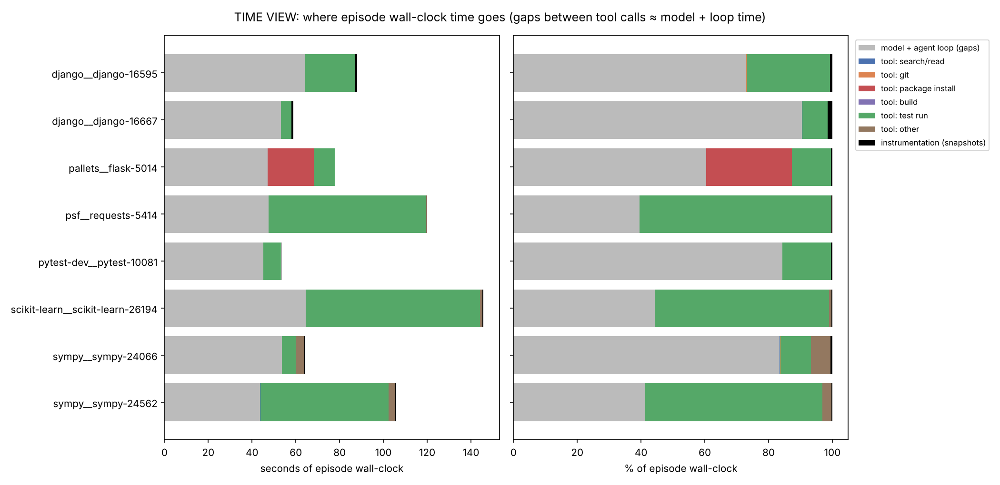
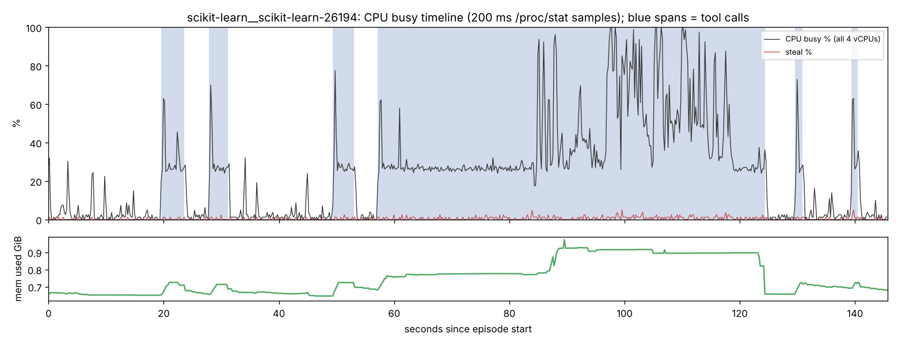
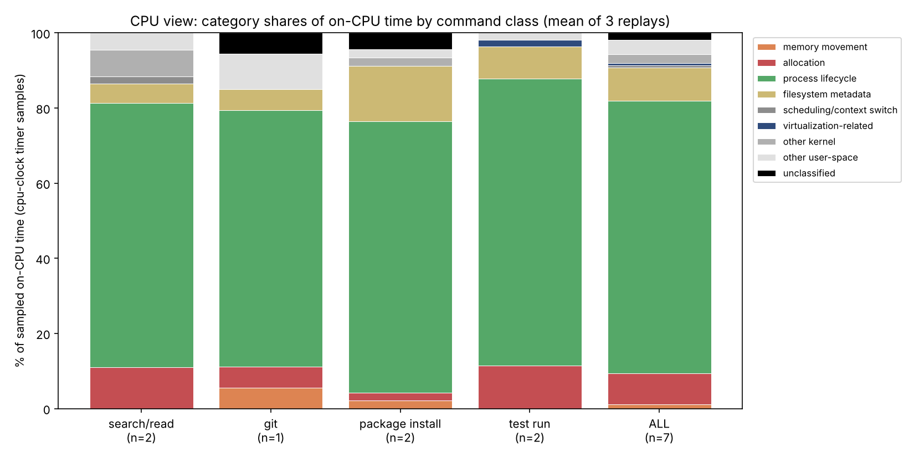
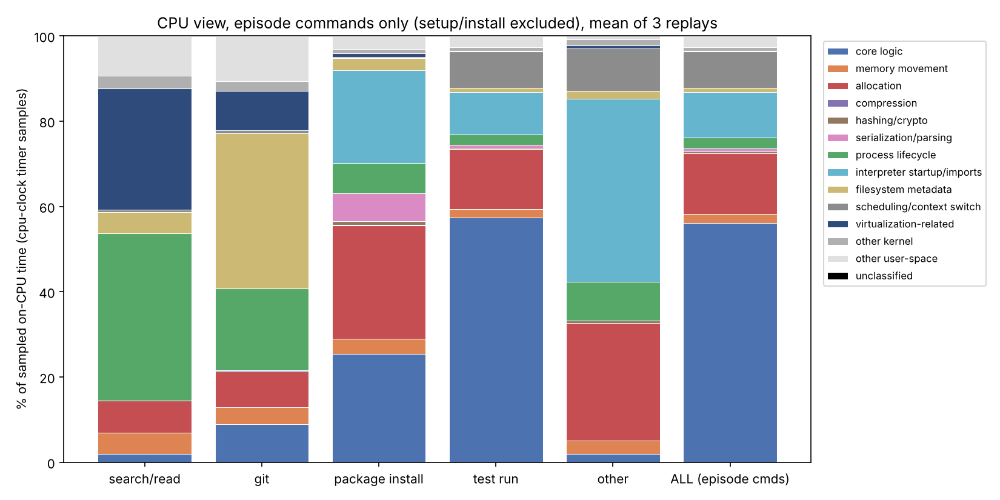

# Where do agent sandbox cycles go? — Report

Exploratory "datacenter tax" characterization of coding-agent sandbox
workloads, modeled on Accelerometer (Sriraman & Dhanotia, ASPLOS '20).
8 SWE-bench Verified tasks, solved live by a coding agent in a Firecracker
microVM (TIME VIEW), then every shell command replayed under `perf`
(CPU VIEW). All CPU numbers are **shares of timer-based on-CPU samples**
(`cpu-clock`, 999 Hz) — not cycles: this VM exposes no hardware counters.

Companion files: `ENV.md` (machine), `TASKS.md` (tasks, setup, outcomes),
`DECISIONS.md` (every judgment call, D0–D17), `TAXONOMY.md` (category
rules). Generated tables live in `results/summary/`, figures in `figs/`.

## Pre-registered hypotheses

Recorded on 2026-11-03, **before any data was collected**. These are not
revised afterwards; the verdicts are in the Results section.

- **H1:** Most episode wall-clock time is model/loop time, not tool execution.
- **H2:** Context switching and threading are significant CPU-time categories.
- **H3:** Memory movement (memcpy/memmove) is a significant CPU-time category.
- **H4:** Process lifecycle (fork/exec, dynamic linking, page faults, Python
  startup/imports) is a significant CPU-time category.

Operationalization (also fixed before data collection):
- "Most" (H1) = more than 50% of the summed episode wall-clock time across
  tasks, and in the majority of individual tasks.
- "Significant" (H2–H4) = at least 5% of the command's sampled on-CPU time,
  aggregated across all replayed commands, or at least 10% in at least one
  command class. "On-CPU time" here means **timer-based on-CPU samples**
  (`cpu-clock` at 999 Hz), not cycles.

## Summary of findings

| Hypothesis | Verdict | Key evidence |
|---|---|---|
| H1 model/loop dominates wall-clock | **Supported** | 58.7% of 714 s summed episode time; > 50% in 5 of 8 tasks. Tool time is 90% test runs. |
| H2 context switching / threading significant | **Not supported** (pre-registered rule) | 1.5% of on-CPU time over all replayed commands; largest class 9.9% (< 10%). Episode-only 8.5%, but mostly OpenMP spin-waiting in one scikit-learn task; kernel scheduler + futex only 0.3% overall / 1.5% of episode commands. |
| H3 memory movement significant | **Not supported** | 2.8% overall; largest class 5.8% (git). Kernel page zeroing/copy-to-user is about half of it. |
| H4 process lifecycle + Python startup/imports significant | **Supported** | 5.2% overall (just over the bar, diluted by compiler time), 13.2% of episode commands, 39–52% for short commands (search/read, ad-hoc Python). Holds under both CPUID mappings. |

Three things the hypotheses did not anticipate:

1. **The sandbox CPU is mostly idle.** Averaged over an episode, the 4-vCPU
   sandbox is 10.8% busy (27.7% during tool calls, 3.5% between them).
   Agent sandboxes are a low-utilization, latency-bound workload.
2. **A microVM tax on every process start.** In this guest one `CPUID`
   instruction costs ~11 µs (it is a VM exit). glibc's dynamic loader issues
   ~100 of them per process start for cache-size detection, so ~67% of a
   `/bin/true` start and ~29% of the on-CPU time of the agent's short
   search/read commands is CPUID exit overhead. Instruction counts (callgrind)
   put the same code at 0.4% — this cost is invisible without timing.
3. **Python memory management is the largest orchestration tax.**
   Allocation + cyclic GC is 12–14% of on-CPU time in test runs and package
   installs, ~2× its share of executed instructions (callgrind) — consistent
   with memory-bound pointer chasing. It is the largest orchestration
   category in test runs, package installs and builds (in ad-hoc scripts,
   imports are larger).

## Method in brief

- **Phase A (TIME VIEW).** The agent (Claude Code in this cloud session,
  effort level `high`, auto permission mode; DECISIONS.md D0) solved each
  task normally. Every shell command went through `tools/run.sh` (ns
  timestamps, exit code); every command and edit was checkpointed by
  `tools/snap.sh` (git commit of the working tree into a private ref, not
  touching HEAD/index); `tools/sample.sh` recorded `/proc/stat` and
  `/proc/meminfo` every 200 ms. **Gaps between agent actions approximate
  model + agent-loop time** (inference, API round trip, harness, permission
  checks); snapshots are counted separately as instrumentation.
- **Phase B (CPU VIEW).** Every recorded command (81: 26 setup, 55 in
  episodes) was replayed from its pre-command checkpoint: an unprofiled
  warm-up, then 3 × `perf stat` + `/usr/bin/time -v` and 3 × `perf record -a
  -g -e cpu-clock -F 999`, each from freshly restored state (10-minute cap).
  Read-only commands under 1 s also got 3 looped profiles (30 executions
  each), weighted so each command still counts once (D8). Samples are
  attributed to the replayed command's process tree; kernel threads are
  kept separately (0.14% of command samples); idle and unrelated processes
  are dropped (unrelated: 0.9% of all samples). Leaf function + syscall +
  stack-context flags → category via the ordered rule table in TAXONOMY.md.
- **Replay interpreter.** The live venvs used a stripped Python 3.11; replays
  swap in an unstripped, frame-pointer CPython 3.11.15 (same ABI) so that
  interpreter internals (pymalloc, GC, parser) resolve (D3).
- **Cross-checks.** callgrind on 7 commands (reduced subsets), `-X
  importtime` on 13 commands, a CPUID microbenchmark, and two public
  bash-only mini-swe-agent trajectories for the same tasks, replayed through
  the identical pipeline (D13).

## Results — TIME VIEW

| Task | episode s | model+loop s (%) | tool s (%) | of which test run s | snapshots s | agent actions | median gap s | resolved |
|---|---|---|---|---|---|---|---|---|
| django__django-16595 | 88 | 64 (73%) | 23.0 (26%) | 22.9 | 0.72 | 6 cmds + 2 edits | 4.5 | resolved |
| django__django-16667 | 59 | 53 (90%) | 4.8 (8%) | 4.7 | 0.85 | 6 cmds + 3 edits | 4.6 | unresolved |
| pallets__flask-5014 | 78 | 47 (60%) | 30.6 (39%) | 9.6 | 0.29 | 7 cmds + 2 edits | 4.3 | resolved |
| psf__requests-5414 | 120 | 48 (40%) | 72.2 (60%) | 72.0 | 0.30 | 8 cmds + 2 edits | 3.8 | resolved |
| pytest-dev__pytest-10081 | 53 | 45 (84%) | 8.2 (15%) | 8.1 | 0.25 | 6 cmds + 2 edits | 4.2 | resolved |
| scikit-learn__scikit-learn-26194 | 146 | 65 (44%) | 80.7 (55%) | 79.6 | 0.45 | 9 cmds + 3 edits | 4.2 | resolved |
| sympy__sympy-24066 | 64 | 54 (84%) | 10.2 (16%) | 6.2 | 0.36 | 8 cmds + 2 edits | 4.6 | resolved |
| sympy__sympy-24562 | 106 | 44 (41%) | 61.7 (58%) | 58.7 | 0.31 | 5 cmds + 2 edits | 3.9 | resolved |
| **total** | 714 | 419 (58.7%) | 291.4 (40.8%) | 261.9 | 3.53 | | | 7/8 |

Episode wall-clock was 54–146 s per task (the agent solved 7 of 8 tasks;
TASKS.md). The median gap between consecutive agent actions was 3.8–4.6 s
per task. Tool execution is dominated by test runs (262 of 291 s; 90%); all
search/read commands together took 0.2 s and git 1.2 s. The three tasks
where tool time exceeds model time (requests, scikit-learn, sympy-24562)
each contain one long test invocation (52–69 s). Setup (clone, venv,
install) is excluded from episodes by design (SWE-bench ships pre-built
environments) and would otherwise dominate: scikit-learn's setup alone took
677 s because `pip install -e .` recompiled every extension after an
explicit `build_ext` (TASKS.md).

**Sandbox CPU utilization** from the 200 ms sampler (busy = user + nice +
system + irq + softirq + steal over all 4 vCPUs):

| Task | mean CPU busy % (4 vCPUs) over episode | during tool calls | between tool calls | mean steal % |
|---|---|---|---|---|
| django__django-16595 | 13.5 | 43.9 | 2.8 | 0.31 |
| django__django-16667 | 7.2 | 42.3 | 4.2 | 0.26 |
| pallets__flask-5014 | 6.4 | 10.8 | 3.5 | 0.21 |
| psf__requests-5414 | 4.0 | 4.5 | 3.3 | 0.16 |
| pytest-dev__pytest-10081 | 7.3 | 26.9 | 3.6 | 0.21 |
| scikit-learn__scikit-learn-26194 | 23.8 | 40.1 | 3.6 | 0.47 |
| sympy__sympy-24066 | 6.6 | 26.4 | 2.9 | 0.16 |
| sympy__sympy-24562 | 17.2 | 26.7 | 3.9 | 0.27 |
| **mean of tasks** | 10.8 | 27.7 | 3.5 | 0.26 |

Per-task timelines (CPU busy %, steal %, memory; blue spans = tool calls)
are in `figs/timeline_<task>.png`; e.g. scikit-learn:

Most tool calls keep about one vCPU busy (~25% of the machine); the
parallel Django test run and OpenMP sections of the scikit-learn tests are
the exceptions. Steal time stayed below 0.5% on average.

## Results — CPU VIEW

### Category shares by command class (all 81 replayed commands)

Mean ± std over the 3 replays (pooled over the commands in each class, i.e.
time-weighted). "raw samples/rep" = timer samples per replay round (999 Hz
per CPU ⇒ ≈ CPU-ms).

| Class | #cmds | raw samples/rep | core logic | memory movement | allocation | compression | hashing/crypto | serialization/parsing | process lifecycle | interpreter startup/imports | filesystem metadata | scheduling/context switch | virtualization-related | other kernel | other user-space | unclassified |
|---|---|---|---|---|---|---|---|---|---|---|---|---|---|---|---|---|
| search/read | 23 | 6884 | 1.9 ± 0.0 | 5.0 ± 0.3 | 7.4 ± 0.2 | 0.0 ± 0.0 | 0.0 ± 0.0 | 0.0 ± 0.0 | 39.3 ± 0.6 | 0.0 ± 0.0 | 5.0 ± 0.2 | 0.5 ± 0.1 | 28.5 ± 0.4 | 3.0 ± 0.1 | 9.2 ± 0.2 | 0.1 ± 0.0 |
| git | 9 | 10532 | 22.9 ± 2.4 | 5.8 ± 1.8 | 7.7 ± 1.0 | 22.3 ± 1.7 | 0.0 ± 0.0 | 0.0 ± 0.0 | 4.5 ± 0.3 | 0.0 ± 0.0 | 18.0 ± 8.4 | 1.0 ± 0.1 | 1.4 ± 0.0 | 9.1 ± 0.6 | 4.1 ± 0.7 | 3.3 ± 0.3 |
| package install | 18 | 828132 | 71.4 ± 0.5 | 3.8 ± 0.2 | 12.5 ± 0.4 | 0.5 ± 0.0 | 0.3 ± 0.0 | 3.9 ± 0.1 | 1.9 ± 0.0 | 3.2 ± 0.1 | 1.1 ± 0.0 | 0.1 ± 0.0 | 0.1 ± 0.0 | 0.5 ± 0.0 | 0.4 ± 0.0 | 0.4 ± 0.0 |
| build | 1 | 603284 | 84.8 ± 0.1 | 1.8 ± 0.0 | 10.5 ± 0.1 | 0.0 ± 0.0 | 0.0 ± 0.0 | 0.0 ± 0.0 | 1.4 ± 0.0 | 0.3 ± 0.0 | 0.1 ± 0.0 | 0.1 ± 0.0 | 0.1 ± 0.0 | 0.2 ± 0.0 | 0.0 ± 0.0 | 0.5 ± 0.0 |
| test run | 24 | 273429 | 57.3 ± 0.4 | 2.0 ± 0.1 | 14.0 ± 0.1 | 0.0 ± 0.0 | 0.3 ± 0.0 | 0.7 ± 0.0 | 2.4 ± 0.0 | 10.0 ± 0.2 | 1.0 ± 0.1 | 8.6 ± 0.2 | 0.1 ± 0.0 | 0.9 ± 0.0 | 2.6 ± 0.0 | 0.1 ± 0.0 |
| other | 6 | 4741 | 1.9 ± 0.2 | 3.2 ± 0.2 | 27.6 ± 1.0 | 0.0 ± 0.0 | 0.6 ± 0.0 | 0.0 ± 0.0 | 9.0 ± 0.5 | 42.9 ± 0.7 | 1.9 ± 0.1 | 9.9 ± 1.0 | 0.7 ± 0.1 | 1.5 ± 0.1 | 0.7 ± 0.2 | 0.0 ± 0.0 |
| ALL | 81 | 1727002 | 73.5 ± 0.2 | 2.8 ± 0.1 | 12.1 ± 0.2 | 0.4 ± 0.0 | 0.2 ± 0.0 | 2.0 ± 0.0 | 1.8 ± 0.0 | 3.3 ± 0.1 | 0.8 ± 0.1 | 1.5 ± 0.0 | 0.1 ± 0.0 | 0.5 ± 0.0 | 0.6 ± 0.0 | 0.4 ± 0.0 |

The ALL row is dominated (72.5% of samples) by two scikit-learn setup
commands that compile C/C++ extensions (`build_ext` and the editable
install that rebuilt them), so it mostly describes **gcc**. The
episode-only view is more representative of what an agent does during a
task:

| Class (episode commands only) | core logic | memory movement | allocation | compression | hashing/crypto | serialization/parsing | process lifecycle | interpreter startup/imports | filesystem metadata | scheduling/context switch | virtualization-related | other kernel | other user-space | unclassified |
|---|---|---|---|---|---|---|---|---|---|---|---|---|---|---|
| search/read | 1.9 ± 0.0 | 5.0 ± 0.3 | 7.4 ± 0.2 | 0.0 ± 0.0 | 0.0 ± 0.0 | 0.0 ± 0.0 | 39.3 ± 0.6 | 0.0 ± 0.0 | 5.0 ± 0.2 | 0.5 ± 0.1 | 28.5 ± 0.4 | 3.0 ± 0.1 | 9.2 ± 0.2 | 0.1 ± 0.0 |
| git | 8.9 ± 0.4 | 4.1 ± 0.4 | 8.3 ± 0.4 | 0.4 ± 0.1 | 0.0 ± 0.0 | 0.0 ± 0.0 | 19.2 ± 0.8 | 0.0 ± 0.0 | 36.3 ± 1.2 | 0.7 ± 0.1 | 9.3 ± 0.1 | 2.2 ± 0.3 | 10.6 ± 0.8 | 0.1 ± 0.0 |
| package install | 25.4 ± 0.9 | 3.6 ± 0.1 | 26.6 ± 0.6 | 0.2 ± 0.1 | 0.8 ± 0.1 | 6.5 ± 1.0 | 7.1 ± 1.0 | 21.7 ± 0.5 | 2.9 ± 0.7 | 0.4 ± 0.2 | 0.8 ± 0.2 | 1.1 ± 0.1 | 2.9 ± 0.2 | 0.1 ± 0.0 |
| test run | 57.4 ± 0.4 | 2.0 ± 0.1 | 14.0 ± 0.1 | 0.0 ± 0.0 | 0.3 ± 0.0 | 0.7 ± 0.0 | 2.4 ± 0.0 | 10.0 ± 0.2 | 1.0 ± 0.1 | 8.6 ± 0.2 | 0.1 ± 0.0 | 0.9 ± 0.0 | 2.6 ± 0.0 | 0.1 ± 0.0 |
| other | 1.9 ± 0.2 | 3.2 ± 0.2 | 27.6 ± 1.0 | 0.0 ± 0.0 | 0.6 ± 0.0 | 0.0 ± 0.0 | 9.0 ± 0.5 | 42.9 ± 0.7 | 1.9 ± 0.1 | 9.9 ± 1.0 | 0.7 ± 0.1 | 1.5 ± 0.1 | 0.7 ± 0.2 | 0.0 ± 0.0 |
| ALL (episode cmds) | 56.1 ± 0.5 | 2.0 ± 0.1 | 14.3 ± 0.1 | 0.0 ± 0.0 | 0.3 ± 0.0 | 0.7 ± 0.0 | 2.6 ± 0.0 | 10.6 ± 0.3 | 1.0 ± 0.1 | 8.5 ± 0.2 | 0.2 ± 0.0 | 0.9 ± 0.0 | 2.6 ± 0.0 | 0.1 ± 0.0 |

Per task (episode commands only):

| task | core logic | memory movement | allocation | compression | hashing/crypto | serialization/parsing | process lifecycle | interpreter startup/imports | filesystem metadata | scheduling/context switch | virtualization-related | other kernel | other user-space | unclassified |
|---|---|---|---|---|---|---|---|---|---|---|---|---|---|---|
| django__django-16595 | 27.3 ± 1.4 | 3.0 ± 0.0 | 22.9 ± 0.4 | 0.0 ± 0.0 | 0.6 ± 0.0 | 1.3 ± 0.1 | 6.6 ± 0.1 | 21.7 ± 0.4 | 2.3 ± 0.0 | 0.6 ± 0.0 | 0.3 ± 0.0 | 0.7 ± 0.1 | 12.7 ± 0.4 | 0.1 ± 0.0 |
| django__django-16667 | 50.3 ± 0.6 | 3.0 ± 0.3 | 19.7 ± 0.7 | 0.0 ± 0.0 | 0.3 ± 0.0 | 0.9 ± 0.1 | 7.5 ± 0.4 | 14.0 ± 0.3 | 1.6 ± 0.1 | 0.5 ± 0.1 | 0.6 ± 0.0 | 0.7 ± 0.0 | 0.7 ± 0.1 | 0.1 ± 0.0 |
| pallets__flask-5014 | 41.8 ± 0.4 | 2.5 ± 0.1 | 23.8 ± 0.6 | 0.1 ± 0.0 | 0.5 ± 0.0 | 3.8 ± 0.2 | 4.6 ± 0.4 | 16.4 ± 0.4 | 2.5 ± 0.3 | 0.4 ± 0.1 | 0.5 ± 0.0 | 1.5 ± 0.2 | 1.5 ± 0.0 | 0.1 ± 0.0 |
| psf__requests-5414 | 42.0 ± 0.3 | 2.3 ± 0.1 | 29.4 ± 0.3 | 0.0 ± 0.0 | 0.5 ± 0.0 | 3.0 ± 0.1 | 3.6 ± 0.1 | 11.9 ± 0.1 | 1.4 ± 0.1 | 1.9 ± 0.1 | 0.4 ± 0.0 | 2.6 ± 0.2 | 0.8 ± 0.1 | 0.0 ± 0.0 |
| pytest-dev__pytest-10081 | 39.8 ± 1.4 | 2.2 ± 0.0 | 22.6 ± 0.8 | 0.0 ± 0.0 | 0.4 ± 0.1 | 0.5 ± 0.1 | 3.7 ± 0.3 | 22.6 ± 0.6 | 5.3 ± 1.2 | 0.4 ± 0.1 | 0.4 ± 0.0 | 1.0 ± 0.1 | 1.1 ± 0.1 | 0.0 ± 0.0 |
| scikit-learn__scikit-learn-26194 | 64.1 ± 0.6 | 1.6 ± 0.1 | 8.1 ± 0.1 | 0.0 ± 0.0 | 0.2 ± 0.0 | 0.1 ± 0.0 | 1.2 ± 0.0 | 3.9 ± 0.1 | 0.4 ± 0.0 | 18.5 ± 0.5 | 0.1 ± 0.0 | 1.1 ± 0.1 | 0.5 ± 0.0 | 0.1 ± 0.0 |
| sympy__sympy-24066 | 23.3 ± 1.0 | 3.1 ± 0.6 | 26.4 ± 1.1 | 0.0 ± 0.0 | 0.6 ± 0.1 | 0.4 ± 0.0 | 5.9 ± 0.5 | 36.7 ± 1.0 | 1.6 ± 0.1 | 0.2 ± 0.1 | 0.5 ± 0.1 | 0.6 ± 0.1 | 0.6 ± 0.0 | 0.0 ± 0.0 |
| sympy__sympy-24562 | 73.5 ± 0.5 | 1.7 ± 0.1 | 12.8 ± 0.1 | 0.0 ± 0.0 | 0.2 ± 0.0 | 0.5 ± 0.0 | 0.9 ± 0.0 | 9.7 ± 0.2 | 0.3 ± 0.0 | 0.0 ± 0.0 | 0.0 ± 0.0 | 0.2 ± 0.0 | 0.2 ± 0.0 | 0.0 ± 0.0 |

What the classes look like:

- **search/read** (grep, sed -n, cat, find): ~12 ms per command and almost
  none of it is the search itself (core logic 1.9%). It is process creation:
  CPUID-bound CPU-feature detection in ld.so 28% (virtualization-related,
  D16), exec/fork/exit syscalls 16%, page faults 12%, the rest of dynamic
  linking 11% (incl. mmap of libraries), shell glue 8%, kernel page
  allocation 5% and page zeroing/copy 4.5%.
- **git**: zlib inflate (22% compression) and the clone's file creation
  (filesystem metadata 18 ± 8%; the large variance is one replay round of the
  Django clone hitting ext4's recently-deleted-inode scan, see Caveats).
- **test run**: interpreter 57%, allocation + GC 14%, imports 10%,
  scheduling 8.6% (almost all OpenMP runtime and `sched_yield` in the
  scikit-learn tests).
- **package install**: in this data, dominated by the compiler (scikit-learn
  editable install); the episode-only install (flask: `pip install
  "pytest<8"`) is 25% core, 27% allocation, 22% imports.
- **other** (ad-hoc reproduction scripts, `python -c` checks): 43% imports +
  9% process lifecycle — these scripts mostly pay for importing sympy /
  sklearn and exit.

Selected sub-categories (share of all on-CPU samples, all commands):
`results/summary/cpu_subcategory_shares.csv`; by class:
`results/summary/cpu_subcategory_shares_by_class.csv`.

### Top 20 leaf functions (all replayed commands, share of on-CPU samples)

| # | Leaf function | DSO | Category | % of on-CPU samples |
|---|---|---|---|---|
| 1 | `[unknown]` | cc1 | core logic | 15.10 |
| 2 | `_PyEval_EvalFrameDefault` | python3.11 | core logic | 6.13 |
| 3 | `file_cache_slot::get_next_line(char**, long*)` | cc1 | core logic | 5.86 |
| 4 | `[unknown]` | cc1plus | core logic | 4.83 |
| 5 | `gc_collect_main` | python3.11 | allocation | 3.65 |
| 6 | `PyObject_GenericGetAttr` | python3.11 | core logic | 2.33 |
| 7 | `_int_malloc` | libc.so.6 | allocation | 1.15 |
| 8 | `__pyx_f_7sklearn_7metrics_29_pairwise_distances_reduction_21_middle_term_computer__middle_term_sparse_sparse_64(__Pyx_memviewslice, __Pyx_memviewslice, __Pyx_memviewslice, long, long, __Pyx_memviewslice, __Pyx_memviewslice, __Pyx_memviewslice, long, long, double*)` | _middle_term_computer.cpython-311-x86_64-linux-gnu.so | core logic | 1.08 |
| 9 | `visit_decref` | python3.11 | allocation | 0.96 |
| 10 | `_PyObject_Malloc` | python3.11 | allocation | 0.96 |
| 11 | `clear_page_erms` | [kernel.kallsyms] | memory movement | 0.86 |
| 12 | `bitmap_set_bit(bitmap_head*, int)` | cc1 | core logic | 0.84 |
| 13 | `_PyEval_EvalFrameDefault` | python3.11 | interpreter startup/imports | 0.80 |
| 14 | `[unknown]` | libgomp.so.1.0.0 | scheduling/context switch | 0.79 |
| 15 | `visit_reachable` | python3.11 | allocation | 0.70 |
| 16 | `__memmove_evex_unaligned_erms` | libc.so.6 | memory movement | 0.68 |
| 17 | `_PyObject_Free` | python3.11 | allocation | 0.63 |
| 18 | `__memset_evex_unaligned_erms` | libc.so.6 | memory movement | 0.58 |
| 19 | `[unknown]` | x86_64-linux-gnu-as | core logic | 0.57 |
| 20 | `rep_movs_alternative` | [kernel.kallsyms] | memory movement | 0.51 |

`cc1`/`cc1plus`/`as` are stripped compiler binaries (attributed by DSO,
TAXONOMY rule U0c). Top-10 leaves per class:
`results/summary/top10_leaf_functions_by_class.csv`.

### Inclusive (stack-context) shares

Leaf-first attribution undercounts activities whose leaves are generic. The
share of samples with a given frame anywhere on the stack:

| Class | lifecycle (incl. page faults, ld.so, teardown) | under fs-metadata syscall | under import/startup | under page fault | under python compile | under python teardown |
|---|---|---|---|---|---|---|
| search/read | 80.4 | 5.4 | 0.0 | 17.8 | 0.0 | 0.0 |
| git | 6.7 | 21.1 | 0.0 | 2.9 | 0.0 | 0.0 |
| package install | 4.7 | 1.2 | 4.7 | 2.7 | 8.7 | 1.5 |
| build | 2.2 | 0.1 | 0.4 | 1.9 | 0.1 | 0.0 |
| test run | 7.5 | 1.1 | 15.3 | 1.9 | 2.8 | 4.9 |
| other | 25.1 | 2.1 | 66.9 | 5.2 | 1.5 | 17.0 |
| ALL | 4.4 | 0.9 | 5.0 | 2.3 | 4.7 | 1.6 |

E.g. 15% of test-run on-CPU time is under an import frame (vs 10% when only
interpreter leaves are counted), and 18% of search/read time is inside page
faults.

### perf stat and rusage by class

Sums over commands (mean of 3 reps per command), normalized per CPU-second
of task-clock; medians per command.

| Class | commands | CPU s (task-clock, sum) | sys share of CPU % | CPU utilization (task-clock / wall) | ctx switches / CPU-s | voluntary cs / CPU-s | involuntary cs / CPU-s | cpu migrations / CPU-s | page faults / CPU-s | median task-clock ms | median ctx sw | median page faults | median maxRSS kB | median wall s |
|---|---|---|---|---|---|---|---|---|---|---|---|---|---|---|
| search/read | 23.00 | 0.29 | 41.67 | 2.66 | 287 | 444 | 21.61 | 80.75 | 45,324 | 12.48 | 3.00 | 559 | 3,355 | 0.00 |
| git | 9.00 | 8.13 | 39.71 | 0.49 | 2,309 | 2,291 | 27.91 | 27.78 | 8,712 | 1,007 | 1,998 | 9,600 | 16,937 | 2.19 |
| package install | 18.00 | 786 | 5.81 | 1.11 | 22.54 | 16.78 | 7.08 | 0.54 | 5,599 | 6,735 | 352 | 54,136 | 79,355 | 6.90 |
| build | 1.00 | 582 | 3.23 | 3.71 | 16.16 | 3.11 | 13.95 | 0.40 | 5,223 | 582,420 | 9,410 | 3,042,050 | 465,791 | 157 |
| test run | 24.00 | 258 | 6.10 | 1.00 | 480 | 122 | 281 | 2.98 | 4,497 | 3,320 | 472 | 22,355 | 73,543 | 2.78 |
| other | 6.00 | 4.36 | 15.76 | 1.16 | 18.34 | 11.38 | 9.86 | 0.92 | 15,356 | 702 | 5.50 | 11,705 | 53,423 | 0.70 |
| ALL | 81.00 | 1,639 | 5.13 | 1.43 | 104 | 39.75 | 52.72 | 1.03 | 5,341 | nan | nan | nan | nan | nan |

Short commands are kernel-heavy (sys share 40–42% for search/read and git vs
6% for test runs) and fault-heavy (45k page faults per CPU-second for
search/read). Test runs context-switch ~480 times per CPU-second (281
of them involuntary); at a few µs per switch that is well under 1% of CPU
time, consistent with the H2 verdict. Repeat-to-repeat variability
of task-clock: median CV 8%, p90 19% (`counters_repeat_cv.csv`).

### Accelerometer inputs

On-CPU time share (mean ± std over 3 replays) of the three categories with
off-the-shelf accelerators:

| Class | compression % | hashing/crypto % | memory movement % |
|---|---|---|---|
| search/read | 0.00 ± 0.00 | 0.00 ± 0.00 | 5.03 ± 0.30 |
| git | 22.29 ± 1.66 | 0.00 ± 0.01 | 5.76 ± 1.83 |
| package install | 0.51 ± 0.04 | 0.32 ± 0.01 | 3.80 ± 0.18 |
| build | 0.00 ± 0.00 | 0.03 ± 0.00 | 1.79 ± 0.05 |
| test run | 0.02 ± 0.00 | 0.31 ± 0.01 | 2.00 ± 0.07 |
| other | 0.01 ± 0.01 | 0.62 ± 0.03 | 3.15 ± 0.15 |
| ALL | 0.36 ± 0.02 | 0.22 ± 0.00 | 2.82 ± 0.11 |

Notes for plugging these in: compression in this workload is zlib
inflate — pip unpacking wheels (the larger part in absolute terms) and
`git clone/fetch` (22% of the small git class); hashing is mostly CPython's
siphash for `str` hashing and SHA-256 in pip (wheel hash checks), while
git's SHA-1 is negligible;
memory movement is split about evenly between user-space `memcpy/memset` and
kernel copy/zero (`clear_page_erms`, `rep_movs_alternative`), see
`cpu_subcategory_shares_by_class.csv`. All are timer-sample shares, not
cycle shares.

## Cross-checks

### callgrind vs perf (user-space only, leaf-only rules)

callgrind counts executed instructions; perf counts on-CPU time. Both sides
use the same taxonomy without stack context. Format: callgrind % / perf %.

| Sample (class) | core cg / perf | alloc cg / perf | memmove cg / perf | ser/parse cg / perf | lifecycle cg / perf | virt (CPUID) cg / perf | sched cg / perf | other-user cg / perf |
|---|---|---|---|---|---|---|---|---|
| grep_sed (search/read) | 8.8 / 3.3 | 10.2 / 3.8 | 2.7 / 1.7 | 0.0 / 0.0 | 32.9 / 16.7 | 0.4 / 56.9 | 0.0 / 0.0 | 43.8 / 17.3 |
| git_diff_status (git) | 75.2 / 27.8 | 8.0 / 6.8 | 2.3 / 1.5 | 0.0 / 0.0 | 5.9 / 9.4 | 0.1 / 26.9 | 0.0 / 0.0 | 5.7 / 26.5 |
| flask_pytest_blueprints (test run) | 70.3 / 59.1 | 15.9 / 30.6 | 1.8 / 1.4 | 10.0 / 6.0 | 0.1 / 0.3 | 0.0 / 0.6 | 0.3 / 0.3 | 0.1 / 1.0 |
| sympy_repro_script (other) | 76.3 / 61.5 | 15.2 / 31.4 | 1.9 / 1.7 | 5.0 / 2.7 | 0.0 / 0.2 | 0.0 / 0.6 | 0.2 / 0.2 | 0.1 / 0.7 |
| sympy_pytest_quantities (test run) | 77.4 / 60.2 | 14.8 / 33.8 | 1.8 / 1.3 | 4.3 / 2.7 | 0.0 / 0.0 | 0.0 / 0.2 | 0.2 / 0.2 | 0.1 / 0.7 |
| django_runtests_optimizer (test run) | 64.6 / 52.6 | 19.8 / 38.2 | 2.1 / 1.6 | 10.3 / 4.0 | 0.2 / 0.6 | 0.0 / 1.2 | 0.4 / 0.4 | 0.3 / 0.9 |
| sklearn_pytest_ranking (test run) | 78.1 / 65.7 | 14.4 / 22.0 | 1.6 / 1.2 | 3.7 / 1.5 | 0.7 / 0.9 | 0.0 / 0.2 | 0.5 / 7.1 | 0.2 / 0.9 |

- For Python commands the two agree on the ranking (core ≫ allocation ≫
  serialization/parsing ≈ memory movement), but **allocation + GC takes
  1.5–2.3× more of the time than of the instructions**, while the interpreter
  loop and the parser take less — consistent with GC/pymalloc being
  memory-bound (high CPI) and the eval loop/parser being compute-bound. No
  cache-miss counters exist here to confirm the mechanism.
- **CPUID**: glibc's feature detection is 0.4% of instructions but 57% of
  user-space time in `grep | sed` (27% in `git diff`).
- **OpenMP**: scheduling is 0.5% of instructions but 7.1% of time in the
  scikit-learn test: valgrind serializes threads, so barrier spin-waits
  barely run under it, while on real CPUs they burn time.
- Per-sample details: `results/callgrind/summary.md`.

### `-X importtime` (PYTHONPROFILEIMPORTTIME=1, mean of 3 runs)

| Command | class | wall s | task-clock s | top-level import time s | import / wall % |
|---|---|---|---|---|---|
| django__django-16595 seq 6 | test run | 0.76 | 0.73 | 0.44 | 57.8 |
| django__django-16595 seq 9 | test run | 10.61 | 19.04 | 0.43 | 4.0 |
| pallets__flask-5014 seq 6 | test run | 1.07 | 1.05 | 0.34 | 31.9 |
| pallets__flask-5014 seq 9 | test run | 3.22 | 3.17 | 0.60 | 18.7 |
| sympy__sympy-24066 seq 6 | other | 0.73 | 0.71 | 0.56 | 76.5 |
| sympy__sympy-24066 seq 9 | test run | 2.30 | 2.28 | 0.82 | 35.9 |
| sympy__sympy-24066 seq 10 | test run | 2.29 | 2.27 | 1.26 | 55.0 |
| psf__requests-5414 seq 9 | test run | 0.87 | 0.84 | 0.45 | 51.2 |
| pytest-dev__pytest-10081 seq 8 | test run | 0.94 | 0.83 | 0.36 | 38.6 |
| django__django-16667 seq 8 | test run | 0.88 | 0.91 | 0.41 | 46.6 |
| sympy__sympy-24562 seq 7 | test run | 3.83 | 3.80 | 0.93 | 24.3 |
| scikit-learn__scikit-learn-26194 seq 8 | test run | 3.73 | 4.27 | 0.97 | 26.0 |
| scikit-learn__scikit-learn-26194 seq 14 | other | 0.89 | 1.43 | 0.67 | 74.8 |

Summed top-level import time (wall time inside the import system, including
module-level code and I/O) is a median **39%** of a sampled command's wall
time (range 4–77%). The 4% case is Django's parallel test run, whose forked
workers inherit already-imported modules. This is consistent with the
stack-based perf metric (15% of test-run on-CPU time under an import frame)
given that importtime also counts imports' module-level execution and
waiting. A first pass under-reported pytest commands because pytest's
output capture swallowed the report; it was redone (D11).

### Public trajectories (optional step)

Two bash-only mini-swe-agent trajectories (public SWE-bench submission
`bash-only/20250726_mini-v1.0.0_claude-sonnet-4-20250514`) for the same
tasks were re-executed and profiled with the identical pipeline (D13).
Episode commands only:

| Source | Task | #cmds | core logic | memory movement | allocation | compression | hashing/crypto | serialization/parsing | process lifecycle | interpreter startup/imports | filesystem metadata | scheduling/context switch | virtualization-related | other kernel | other user-space | unclassified |
|---|---|---|---|---|---|---|---|---|---|---|---|---|---|---|---|---|
| mini-swe-agent (public trajectory) | psf__requests-5414 | 39 | 2.3 | 4.2 | 24.9 | 0.0 | 0.8 | 0.0 | 15.9 | 39.3 | 3.3 | 0.3 | 5.4 | 1.0 | 2.3 | 0.1 |
| mini-swe-agent (public trajectory) | pytest-dev__pytest-10081 | 24 | 31.1 | 2.7 | 22.8 | 0.0 | 0.5 | 0.5 | 5.9 | 28.8 | 4.9 | 0.3 | 0.7 | 0.8 | 1.0 | 0.0 |
| this study (Claude Code episode) | psf__requests-5414 | 8 | 42.1 | 2.3 | 29.4 | 0.0 | 0.5 | 3.0 | 3.6 | 11.9 | 1.4 | 1.9 | 0.4 | 2.6 | 0.8 | 0.0 |
| this study (Claude Code episode) | pytest-dev__pytest-10081 | 6 | 39.8 | 2.2 | 22.6 | 0.0 | 0.4 | 0.5 | 3.7 | 22.6 | 5.3 | 0.4 | 0.4 | 1.0 | 1.1 | 0.0 |

That agent issues 3–5× more commands, many of them tiny Python scripts and
`sed -i` edits, so its CPU goes to interpreter startup/imports (29–39%),
process lifecycle and allocation; this study's agent ran fewer, larger
test commands, so more of its CPU is core interpreter work. The *mix* of
orchestration categories (imports, allocation, lifecycle) is similar; the
proportions depend strongly on how the agent batches work into commands.

## Hypothesis verdicts in detail

Evaluated by `tools/hypotheses.py` with the pre-registered thresholds.

# Hypothesis evaluation (generated by tools/hypotheses.py)

#### H1 — model/loop time vs tool execution

Summed over 8 episodes: model + loop = 419 s of 714 s = **58.7 %**; tool execution = 40.8 %; instrumentation (snapshots) = 0.5 %.
Tasks where model + loop > 50 %: **5 of 8** (per task: django-16595 73%, django-16667 90%, flask-5014 60%, requests-5414 40%, pytest-10081 84%, scikit-learn-26194 44%, sympy-24066 84%, sympy-24562 41%).

#### H2 — scheduling / context switch / threading (category total)

| Scope | Aggregate share (mean ± std over 3 reps) | Largest class share | Meets 'significant'? |
|---|---|---|---|
| all replayed commands | 1.49 ± 0.03 % | 9.9 % (other) | no |
| episode commands only | 8.52 ± 0.17 % | 9.9 % (other) | yes |

Per class (all replayed commands): build 0.1%, git 1.0%, other 9.9%, package install 0.1%, search/read 0.5%, test run 8.6%

#### H2 (component) — kernel scheduler + futex only

| Scope | Aggregate share (mean ± std over 3 reps) | Largest class share | Meets 'significant'? |
|---|---|---|---|
| all replayed commands | 0.28 ± 0.01 % | 4.3 % (other) | no |
| episode commands only | 1.52 ± 0.07 % | 4.3 % (other) | no |

Per class (all replayed commands): build 0.0%, git 0.9%, other 4.3%, package install 0.0%, search/read 0.4%, test run 1.5%

#### H3 — memory movement (memcpy/memmove/memset, kernel copy/zero)

| Scope | Aggregate share (mean ± std over 3 reps) | Largest class share | Meets 'significant'? |
|---|---|---|---|
| all replayed commands | 2.82 ± 0.11 % | 5.8 % (git) | no |
| episode commands only | 2.04 ± 0.07 % | 5.0 % (search/read) | no |

Per class (all replayed commands): build 1.8%, git 5.8%, other 3.2%, package install 3.8%, search/read 5.0%, test run 2.0%

#### H4 — process lifecycle + interpreter startup/imports (main taxonomy; CPUID detection counted as virtualization)

| Scope | Aggregate share (mean ± std over 3 reps) | Largest class share | Meets 'significant'? |
|---|---|---|---|
| all replayed commands | 5.15 ± 0.08 % | 51.9 % (other) | yes |
| episode commands only | 13.24 ± 0.32 % | 51.9 % (other) | yes |

Per class (all replayed commands): build 1.7%, git 4.5%, other 51.9%, package install 5.0%, search/read 39.3%, test run 12.4%

#### H4 (variant) — same, with glibc CPUID feature detection counted as dynamic linking (taxonomy before D16)

| Scope | Aggregate share (mean ± std over 3 reps) | Largest class share | Meets 'significant'? |
|---|---|---|---|
| all replayed commands | 5.24 ± 0.08 % | 67.5 % (search/read) | yes |
| episode commands only | 13.37 ± 0.32 % | 67.5 % (search/read) | yes |

Per class (all replayed commands): build 1.7%, git 5.6%, other 52.6%, package install 5.1%, search/read 67.5%, test run 12.5%

#### H4 (component) — process lifecycle only

| Scope | Aggregate share (mean ± std over 3 reps) | Largest class share | Meets 'significant'? |
|---|---|---|---|
| all replayed commands | 1.83 ± 0.01 % | 39.3 % (search/read) | yes |
| episode commands only | 2.60 ± 0.02 % | 39.3 % (search/read) | yes |

Per class (all replayed commands): build 1.4%, git 4.5%, other 9.0%, package install 1.9%, search/read 39.3%, test run 2.4%

#### H4 (component) — interpreter startup/imports only

| Scope | Aggregate share (mean ± std over 3 reps) | Largest class share | Meets 'significant'? |
|---|---|---|---|
| all replayed commands | 3.32 ± 0.07 % | 42.9 % (other) | yes |
| episode commands only | 10.64 ± 0.30 % | 42.9 % (other) | yes |

Per class (all replayed commands): build 0.3%, git 0.0%, other 42.9%, package install 3.2%, search/read 0.0%, test run 10.0%

- **H1 — supported.** The margin is moderate (58.7%) and task-dependent:
  any task with one long test run flips to tool-dominated. The gaps include
  everything that is not tool execution (inference, network, harness,
  permission classification, the extra checkpoint tool call per edit), so
  they upper-bound pure model time.
- **H2 — not supported** under the pre-registered rule (1.5% aggregate;
  largest class 9.9%, just below 10%). Restricted to episode commands the
  category reaches 8.5%, but it is concentrated in one task (scikit-learn,
  18.5% of its episode time) and is mostly OpenMP barrier spin-waiting and
  `sched_yield` — threading *waste*, attributed via the libgomp DSO (D15) —
  rather than kernel context-switch work (kernel scheduler + futex: 0.3%
  overall, 1.5% of episode commands). Off-CPU blocking is invisible to
  on-CPU sampling by design. Note also that timer sampling biases kernel
  time toward interrupt-enable points such as `finish_task_switch` (see
  Caveats), which if anything inflates this category.
- **H3 — not supported.** 2.8% overall, never above 5.8% in any class.
  The largest component is kernel page zeroing/copy for short-lived
  processes, not application `memcpy`.
- **H4 — supported.** 5.2% aggregate is only just above the threshold
  because two compiler-bound setup commands contribute 72.5% of all samples;
  for episode commands it is 13.2%, and for short commands it dominates
  (search/read 39% even after moving the CPUID cost to virtualization; 68%
  with the original mapping). Interpreter startup/imports is the larger
  half overall (3.3% vs 1.8%; 10.6% vs 2.6% for episode commands).

## What did not go as planned (plain list)

- **Pushing to GitHub failed for the whole study** (HTTP 403: the session's
  GitHub App has no write access to `anican/agent-tax`; API branch creation
  also 403). All work is committed locally on
  `claude/environment-diagnostics-8tfnrb` (D4).
- Building CPython from the python.org tarball was refused by the session's
  permission classifier; a uv-managed python-build-standalone 3.11.15 was
  used for replays instead (D3).
- Live episodes ran on a stripped interpreter; replays on a different 3.11
  build (D3).
- The first wave-1 replay mis-parsed `perf script` output; it was caught by
  a sanity check and fully redone (D7).
- Replay-harness artifacts were found and fixed before reporting: ext4
  inode-allocation churn from deleting scratch dirs, venv state not
  checkpointed, stripped interpreter in recorded setup commands (D10).
- The wave-2 batch was killed by the 2-hour background-command limit; it was
  resumed at rep granularity, and one empty `perf stat` repetition was
  re-measured (D14, D15).
- Two cross-check bugs (importtime capture, callgrind header parsing) were
  found and fixed before use (D11).
- Two post-hoc taxonomy/classification changes were made with explicit
  evidence: libgomp → scheduling (D15) and CPUID feature detection →
  virtualization (D16); one command changed class (D17).
- One task (django__django-16667) was not resolved (TASKS.md).
- Only 2 of the 5 downloaded public trajectories were replayed (the others'
  venvs had already been cleaned up).

## Caveats

1. **Timer-based sampling, not cycles.** No hardware PMU is exposed to the
   guest (ENV.md), so every CPU-view number is a share of `cpu-clock`
   samples (999 Hz hrtimer, per CPU) = a share of *on-CPU time*. There is no
   IPC, cycle, cache-miss or stall data; a category with low IPC and one with
   high IPC look the same per unit of time. Sampling via a software hrtimer
   also skids in kernel code that runs with interrupts disabled: such time is
   charged to where interrupts are re-enabled (`_raw_spin_unlock_irqrestore`,
   `finish_task_switch`), biasing attribution toward those functions.
2. **Kernel symbol resolution worked** (kptr_restrict = 0, root, kallsyms
   readable; perf 6.8 userspace on a 6.18 kernel). Call chains were complete;
   frame-pointer unwinding of Python worked with the replay interpreter.
   Some third-party wheels (OpenMP runtime, OpenBLAS, compilers) are
   stripped; their internals are attributed by DSO or left UNCLASSIFIED
   (0.4% of samples overall).
3. **MicroVM.** Everything ran in a Firecracker/KVM guest with 4 vCPUs.
   Hypervisor work is invisible to in-guest sampling except where it shows
   up as time attributed to the trapping guest instruction (CPUID) or as
   steal. "virtualization-related" is therefore a lower bound; the CPUID
   finding is specific to this hypervisor configuration (11 µs per CPUID is
   far slower than typical KVM) and would look very different on bare metal.
4. **Cloud-VM noise.** Absolute times vary (task-clock CV median 8%, p90
   19% across repeats); the report emphasizes shares, with std over 3
   replays. One replay round of the Django clone spent 26% of its samples in
   ext4's recently-deleted-inode scan (a filesystem-state effect that the
   harness fix of D10 reduced but did not eliminate for that command); it
   is kept and shows up as the ±8 pp variance of git's filesystem-metadata
   share.
5. **Replay ≠ live run.** CPU profiles come from replays, not from the live
   episodes: different (symbol-rich) 3.11 build, warm page and bytecode
   caches (the live run's first test invocation also compiled bytecode),
   warm pip download cache, fresh scratch venvs for installs, output written
   to a file instead of a pipe to the agent harness (D3, D6, D10).
6. **Scope.** Python repositories only, SWE-bench Verified only, 8 tasks,
   one agent (Claude Code, one model at effort `high`, auto permission
   mode), which explored with shell commands as instructed (D2). Agents
   that use built-in file tools, containers, or many small scripts (see the
   mini-swe-agent comparison) produce different command mixes. Model time
   depends on the model, effort level, harness version and API load.
7. **Logging perturbation.** Each command paid for the `run.sh` wrapper and
   a git snapshot (0.5% of episode time, shown separately); each edit cost
   one extra tool call for its checkpoint, which inflates model/loop time
   slightly (D1).
8. **Small samples.** Few commands per class for some classes (build: 1
   command; other: 6). Sample counts are listed with every share.

## Extension (2026-11-05, different model; DECISIONS.md D18)

Two follow-up measurements in the same VM, plus the comparison document
`AGENTIC_VS_TRADITIONAL.md` (patterns unique to agentic workloads vs.
traditional services, with a SWOT-style summary).

**Process-start cost decomposition** (`results/microbench/README.md`): CPU
per fork+exec+exit, mean of 3 runs — no-libc binary 114 µs; static glibc
binary 709 µs; dynamic glibc binary 811 µs; `/bin/true` 832 µs; `grep` on a
1-line file 993 µs; `python -S -c pass` 6.4 ms; `python -c pass` 8.2 ms;
`python -c "import json,re,os"` 14.8 ms. The ~595 µs that glibc adds even
without a dynamic loader is the CPUID-driven cache probing (D16); the
dynamic loader itself adds only ~100 µs. `GLIBC_TUNABLES` cache-size
settings do not avoid it.

**Sandbox density** (`results/density/summary.md`, `figs/density.png`): N
concurrent copies of a tool command on 4 vCPUs. No measurable slowdown up
to N = 4; linear ≈ N/4 beyond; Python test runs reach 3.1–3.9× aggregate
throughput at saturation (ideal 4×), the exec-bound workload 4.0–4.3×;
steal < 1%. The knee is at concurrently *executing* tool calls = cores.

**Three fresh episodes with a different model** (E1 django-16569, E2
sympy-24539, E3 pytest-10051; TASKS.md "Extension"): all resolved; episode
wall-clock 43–86 s; model/loop share **94.7%** summed (94–95% per task) vs
58.7% in the original 8, because the agent ran only narrow test selections
(2.4–3.8 s of tool time per episode); median gap between agent actions
5.6–7.5 s vs 3.8–4.6 s originally (`results/summary/time_view_per_task_extension.csv`,
`figs/time_breakdown.png` bottom rows). H1 holds for both models; the
model/loop share is governed by the agent's test-scope decisions
(AGENTIC_VS_TRADITIONAL.md row 11), not by the sandbox. CPU-view replays
of these 23 commands are in `results/<task>/` and summarized below once
complete.

Episode commands only (setup excluded), mean ± std over 3 replays, pooled over commands (time-weighted). Commands: extension (new model): 16, original (8 episodes): 55.

| Set | core logic | memory movement | allocation | compression | hashing/crypto | serialization/parsing | process lifecycle | interpreter startup/imports | filesystem metadata | scheduling/context switch | virtualization-related | other kernel | other user-space | unclassified |
|---|---|---|---|---|---|---|---|---|---|---|---|---|---|---|
| extension (new model) | 55.4 ± 0.5 | 1.7 ± 0.2 | 17.9 ± 0.2 | 0.0 ± 0.0 | 0.4 ± 0.1 | 0.5 ± 0.1 | 4.9 ± 0.1 | 13.8 ± 0.2 | 2.8 ± 0.2 | 0.3 ± 0.1 | 0.7 ± 0.0 | 1.1 ± 0.1 | 0.5 ± 0.0 | 0.0 ± 0.0 |
| original (8 episodes) | 56.1 ± 0.5 | 2.0 ± 0.1 | 14.3 ± 0.1 | 0.0 ± 0.0 | 0.3 ± 0.0 | 0.7 ± 0.0 | 2.6 ± 0.0 | 10.6 ± 0.3 | 1.0 ± 0.1 | 8.5 ± 0.2 | 0.2 ± 0.0 | 0.9 ± 0.0 | 2.6 ± 0.0 | 0.1 ± 0.0 |

| Extension task | core logic | memory movement | allocation | compression | hashing/crypto | serialization/parsing | process lifecycle | interpreter startup/imports | filesystem metadata | scheduling/context switch | virtualization-related | other kernel | other user-space | unclassified |
|---|---|---|---|---|---|---|---|---|---|---|---|---|---|---|
| django__django-16569 | 64.4 ± 0.2 | 1.9 ± 0.2 | 17.4 ± 0.3 | 0.0 ± 0.0 | 0.2 ± 0.1 | 0.5 ± 0.0 | 5.2 ± 0.2 | 6.9 ± 0.2 | 1.0 ± 0.0 | 0.4 ± 0.1 | 0.5 ± 0.0 | 1.1 ± 0.1 | 0.6 ± 0.1 | 0.0 ± 0.0 |
| pytest-dev__pytest-10051 | 49.8 ± 1.0 | 1.4 ± 0.1 | 16.5 ± 0.5 | 0.0 ± 0.0 | 0.4 ± 0.1 | 0.4 ± 0.1 | 3.5 ± 0.4 | 19.1 ± 0.5 | 6.1 ± 0.5 | 0.2 ± 0.1 | 0.8 ± 0.1 | 1.3 ± 0.2 | 0.5 ± 0.1 | 0.0 ± 0.0 |
| sympy__sympy-24539 | 25.9 ± 0.4 | 1.9 ± 0.2 | 25.0 ± 0.8 | 0.0 ± 0.0 | 0.8 ± 0.1 | 0.9 ± 0.1 | 8.3 ± 1.2 | 32.4 ± 1.2 | 1.5 ± 0.4 | 0.2 ± 0.2 | 1.2 ± 0.1 | 1.1 ± 0.1 | 0.6 ± 0.2 | 0.0 ± 0.0 |

| Extension class | core logic | memory movement | allocation | compression | hashing/crypto | serialization/parsing | process lifecycle | interpreter startup/imports | filesystem metadata | scheduling/context switch | virtualization-related | other kernel | other user-space | unclassified |
|---|---|---|---|---|---|---|---|---|---|---|---|---|---|---|
| other | 1.6 ± 0.8 | 2.8 ± 0.7 | 26.6 ± 0.6 | 0.0 ± 0.0 | 1.0 ± 0.9 | 0.1 ± 0.2 | 11.2 ± 2.4 | 51.2 ± 2.5 | 1.5 ± 0.3 | 0.2 ± 0.4 | 1.9 ± 0.5 | 1.2 ± 0.8 | 0.7 ± 0.4 | 0.0 ± 0.0 |
| search/read | 2.3 ± 0.6 | 1.8 ± 0.4 | 6.4 ± 0.3 | 0.0 ± 0.0 | 0.0 ± 0.0 | 0.0 ± 0.0 | 34.5 ± 1.0 | 0.0 ± 0.0 | 3.0 ± 0.2 | 0.4 ± 0.3 | 38.1 ± 1.1 | 5.3 ± 0.4 | 8.2 ± 0.4 | 0.1 ± 0.0 |
| test run | 57.1 ± 0.4 | 1.7 ± 0.1 | 17.7 ± 0.2 | 0.0 ± 0.0 | 0.3 ± 0.0 | 0.5 ± 0.1 | 4.6 ± 0.1 | 12.8 ± 0.0 | 2.9 ± 0.2 | 0.3 ± 0.1 | 0.5 ± 0.0 | 1.1 ± 0.2 | 0.5 ± 0.0 | 0.0 ± 0.0 |

## Reproducing / file map

- `tools/run.sh`, `tools/snap.sh`, `tools/sample.sh`, `tools/episode.sh` —
  Phase A instrumentation; `tools/restore.sh` — checkpoint restore;
  `tools/eval_task.sh` — hidden-test resolution check.
- `tools/replay.py`, `tools/replay_loop.py`, `tools/perfparse.py` —
  Phase B; `tools/taxonomy.py` — categories; `tools/analyze.py`,
  `tools/hypotheses.py` — tables/figures; `tools/build_report.py` — this
  report.
- `tools/callgrind_check.py`, `tools/importtime.py`,
  `tools/microbench/cpuid_cost.c`, `tools/traj_record.sh`,
  `tools/extract_traj_cmds.py` — cross-checks.
- `logs/<task>/calls.jsonl` (every command, edit checkpoint and episode
  marker with ns timestamps), `logs/<task>/sampler.csv`,
  `logs/<task>/out/` (command outputs, truncated at 200 kB),
  `logs/<task>/eval.*` (resolution checks).
- `results/<task>/<seq>/` — per-replay `perf stat` CSV, `time -v`,
  parsed profile JSON (raw zstd `perf.data` kept locally, git-ignored).
